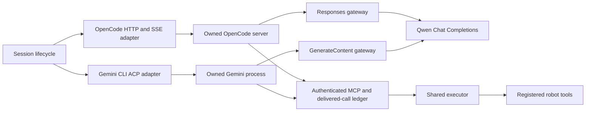

# OpenCode and Gemini CLI backends

These experimental adapters run the native OpenCode or Gemini CLI agent loop
against Qwen in `tool_calling` interaction mode. On 2026-11-06, both runtimes below
passed the real Qwen image/tool smoke fixture with `qwen3.8-flash` on Alibaba
Model Studio. The Gemini compatibility build also passed its upstream build,
full type-check and bundle commands. These checks establish the tested protocol
and tool loop; they do not establish environment task or real-hardware success.

| Tested runtime | Exact artifact |
|---|---|
| OpenCode | `1.19.5`, official Linux x64 baseline release |
| Gemini CLI | `0.69.0-nightly.20261104.g89e9d25d6`, compatibility patch applied to source revision `3fd7d263466b9e5d30b2da1ebf85dae956a0fb86`, built with Node `v22.16.0` |

Each smoke run delivered the observation image to Qwen, preserved two identical
record calls as distinct model call IDs, and completed the finish receipt with
complete gateway records. Version arguments prevent unnoticed upgrades; other
runtime versions and provider/model combinations require their own validation.

Install the CLIs separately. Use a Qwen endpoint accepting Alibaba's non-thinking
Chat Completions parameters, with function calling and image input. Arbitrary
OpenAI-compatible services are not automatically supported. Existing Codex and
Claude Code selections retain their defaults.

Both Qwen adapters encode inline PNG images as lossless WebP at the provider
boundary, preserving decoded pixels and image dimensions. Original CLI requests
remain unchanged; Gemini's Chat training view records the same encoded images
sent to Qwen. Other image formats pass through unchanged. Lossless conversion
does not bound accumulated history or guarantee that a request fits the provider's
body limit; long image histories can still exceed that limit.

## Architecture



`agents/managed.py` owns subprocess lifetime, isolated state, version checks,
episode limits and results. Each backend owns its control transport, configuration
and native events. `agents/tool_binding.py` owns model-call identity and callback
admission. Providers translate wire formats; they never execute tools. The
existing executor owns scheduling and job receipts. Robot tools and sessions
do not gain backend-specific branches.

| Contract | OpenCode | Gemini CLI |
|---|---|---|
| Selection | `--agent opencode` | `--agent gemini_cli` |
| Control | Owned `serve`, HTTP commands, SSE events | Owned `--experimental-acp`, JSON-RPC over stdio |
| Model ingress | Responses through `@ai-sdk/openai` | GenerateContent JSON or buffered SSE |
| Default profile | `aliyun.chat_completions` | `aliyun.gemini_chat_completions` |
| Tool identity | Plugin `callID` in private callback arguments | ACP `callId` in MCP metadata through a source patch |
| Records | `opencode_responses/` | `gemini_generate_content/` |
| Context | `identity` | `identity` |
| Reasoning | `none`, Qwen thinking disabled | `none`, Qwen thinking disabled |

Both adapters support one episode per instance and reject `code_as_policy`
interaction. Resume, subagents, Google-native
grounding, Google thought signatures, arbitrary model routing and validated SFT
export are unsupported. The CLI's public `skip_thought_signature_validator`
sentinel is accepted only on model history and omitted from Qwen requests; it
contains no Google reasoning state. Gemini `countTokens`, upload and caching
operations are rejected. Unknown generation options fail explicitly. Long-context
behavior, inherited system-level CLI settings and image transformations beyond
the smoke fixture require separate verification. `identity` describes the harness policy, not a guarantee that a
CLI will never modify its own history.

## Delivery, limits and completion

1. The gateway buffers a full upstream exchange. Invalid or truncated function
   calls cannot become executable callbacks.
2. The binding registers exact model call IDs, names and arguments. IDs cannot
   be reused within an episode.
3. Successful final response delivery enables calls; a failed send revokes them.
   Callbacks without a matching identity cannot execute.
4. Private identity is removed before schema validation. Each callback is claimed
   once and submitted through the executor. Within a model batch, robot calls
   wait for the previous callback's executor acknowledgement. An accepted
   background job can continue under the shared scheduler.
5. A queued `finish` waits for its job receipt. Success requires a valid result
   with `submitted: true`, normal agent termination and no provider error.
   Agent completion does not establish environment task success.

Cancellation closes callback admission and terminates the owned planner. It does
not stop an executing physical operation. Cleanup drains admitted callbacks and
reports incomplete cleanup. The ledger is in memory: restarting an interrupted
episode must not replay uncertain physical work.

`max_turns` counts successfully delivered model exchanges, including final text;
zero disables the cap. Tool calls are counted separately. Provider retry settings
apply to model requests. Terminal provider failures cancel the adapter to prevent
an outer CLI retry from creating more work. CLI invalid-content retry behavior
still needs verification with the selected build.

## OpenCode setup

Set `UNI_ROBOT_AGENT_PROVIDER_URL` to the Qwen Chat API root and
`UNI_ROBOT_AGENT_API_KEY` in the environment. Keep credentials out of command
arguments and Git. Supply the exact reviewed binary version:

```bash
uni-robot-agent run --integration robouse --agent opencode \
  --model "$QWEN_MODEL" --env-url "$EPISODE_URL" --no-sam3 \
  --opencode-binary /path/to/opencode --opencode-version "$OPENCODE_VERSION"
```

The adapter creates per-run workspace/XDG directories, disables project config,
uses one primary robot agent and disables automatic compaction and title/summary
agents. Model and MCP credentials use environment substitutions. MCP has a
per-run bearer token; the control server has a separate password. Native file
and shell tools remain available. The working directory is not an OS sandbox.
The robot agent's external-directory rule allows only the current episode tree,
so native reads can reopen observation images and calculations can use its scratch
directory. Other episodes remain outside that allowance. The CLI's `TMPDIR` is
`<episode>/opencode/tmp`, keeping its native temporary files inside the same tree.

OpenCode may snapshot tool arguments while the before hook has attached private
MCP identity. The messages hook removes that field from copies of robot-tool
history before model serialization, including failed calls. Original snapshots,
call IDs and ordinary arguments remain intact; callback admission still requires
an exact match to the delivered model call.

OpenCode 1.19.5 bundles its runtime, but loading a local plugin still waits for
configuration-directory dependencies, including `@opencode-ai/plugin`. Its
internal package installer may need registry access; installing a separate Node
or Bun executable does not remove that requirement. Fresh per-run XDG state can
repeat cold dependency work. A measured full configuration took 38.5 seconds to
initialize, compared with 0.9 seconds for a minimal configuration; neither probe
called a model or a robot. Startup therefore has one bounded 120-second budget
for server discovery, health and SSE readiness. HTTP commands use the same
configured timeout instead of a separate ten-second cutoff. Python callers can
override `startup_timeout_s`; runtime logs remain under `opencode/data/opencode/log/`.
Dependencies and configuration are not shared across episodes to bypass isolation.

## Gemini compatibility build

The reviewed ACP source exposes `callId` before executing an MCP tool, but its
native MCP invocation does not forward it. The bridge replaces execution only
for tools belonging to the `ura` server. Native discovery/schemas, the ACP loop
and other tools retain their upstream path. The bridge preserves text/images,
checks response identity and makes one HTTP attempt per callback. Errors enter
the CLI's normal failed-call path.

Use a disposable checkout of the official Gemini CLI repository. The tested
revision is `3fd7d263466b9e5d30b2da1ebf85dae956a0fb86`; retain its complete build
output and manifest. Review and pin the source revision, then apply the patch:

```bash
python -m uni_robot_agent.agents.gemini_cli.bridge apply /path/to/gemini-source \
  --revision "$GEMINI_SOURCE_SHA"
```

This requires a clean checkout and exactly one matching ACP execution seam. It
records source hashes and copies `robotBridge.ts`. Build and type-check using
that revision's upstream build procedure. Start with a fresh `bundle/` directory
when rebuilding, so obsolete chunks are not retained. The bridge may live in the
entry point or an imported JavaScript chunk. Sealing records every file beneath
`bundle/`, including policies and built-in skills, and rejects symbolic links.
Write the manifest outside that directory:

```bash
python -m uni_robot_agent.agents.gemini_cli.bridge seal /path/to/gemini-source \
  --binary /path/to/gemini-source/bundle/gemini.js --version "$GEMINI_VERSION" \
  --output /path/to/gemini-bridge-manifest.json

uni-robot-agent run --integration robouse --agent gemini_cli \
  --model "$QWEN_MODEL" --env-url "$EPISODE_URL" --no-sam3 \
  --gemini-binary /path/to/gemini-source/bundle/gemini.js \
  --gemini-version "$GEMINI_VERSION" \
  --gemini-bridge-manifest /path/to/gemini-bridge-manifest.json
```

Startup checks the exact version and every file hash, rejecting added, removed
or changed files. Existing single-file manifests remain supported. The manifest
detects changes; it is not a signature or proof of an upstream build. Running an episode never
patches a globally installed CLI. Its private trust file permits only the session's
scratch workspace, allowing native MCP discovery without disabling folder trust.
The CLI includes only the current episode directory as an additional workspace,
so native tools can read observation/calibration artifacts and write calculations
in the episode's scratch directory. Other episodes are outside that allowance;
unexpected interactive permission requests are still rejected.
State uses `GEMINI_CLI_HOME`, the assembled system prompt uses `GEMINI_SYSTEM_MD`, and the Google base URL targets the local
GenerateContent gateway. Provider authentication replaces the local Google key
with the configured Qwen credential.

Gemini's native loop detection is disabled through `model.disableLoopDetection`.
Its periodic auxiliary classifiers select Google models outside this Qwen bridge;
the reviewed CLI first invokes them at turn 30. The harness still enforces the
configured delivered-exchange cap and episode timeout. With `--max-turns 0`,
only the wall-clock budget bounds a repetitive planner; no native loop cutoff
is claimed.

Native long-context compression is not supported by this Qwen integration.
Disabling experimental context management does not disable the reviewed CLI's
legacy compression path, which selects a Google auxiliary model. Unsupported
model routes, auxiliary API operations such as `countTokens`, and malformed
Gemini requests are archived as failed exchanges and stop the owning agent
with `provider_error` before an upstream request or tool callback. No compression
threshold override is used to imply support.

Python callers use the same `AgentConfig` fields: `opencode_binary`,
`opencode_version`, `gemini_binary`, `gemini_version`, `gemini_bridge_manifest`.
Options belonging to another backend are rejected. `--validate-config` checks
configuration offline; binary and manifest checks happen at runtime startup.

## Validation before use

Build and type-check the Gemini compatibility runtime using its upstream
procedure. Standard package-content and installed SDK checks include both
bridge assets.

After installing the candidate wheel and reviewed CLI, run the real Qwen fixture:

```bash
python scripts/validation/agent_backends.py --agent opencode \
  --binary /path/to/opencode --version "$OPENCODE_VERSION" \
  --model "$QWEN_MODEL" --output /path/to/new-opencode-run

python scripts/validation/agent_backends.py --agent gemini_cli \
  --binary /path/to/gemini-source/bundle/gemini.js --version "$GEMINI_VERSION" \
  --bridge-manifest /path/to/gemini-bridge-manifest.json \
  --model "$QWEN_MODEL" --output /path/to/new-gemini-run
```

The inert fixture observes a generated color image and nonce, records the same
nonce twice, then submits the color. It checks distinct claimed IDs, image
presence in actual Qwen requests, call order, finish receipts and complete gateway
records. Failure returns a nonzero exit status. `validation.json` and native traces
retain the evidence. This uses model requests and loopback ports without a robot.
Next validate actual CLI cancellation/background execution, then normal integration
episodes. A smoke pass is not evidence of real-hardware success.

Upstream references: [OpenCode server](https://opencode.ai/docs/server/),
[OpenCode plugins](https://opencode.ai/docs/plugins/),
[Gemini ACP](https://github.com/google-gemini/gemini-cli/blob/main/packages/cli/src/acp/acpSession.ts),
[Gemini model config](https://github.com/google-gemini/gemini-cli/blob/main/packages/core/src/config/defaultModelConfigs.ts).
These moving references explain the seam; retain pinned revisions and build
evidence when validating an external runtime.
